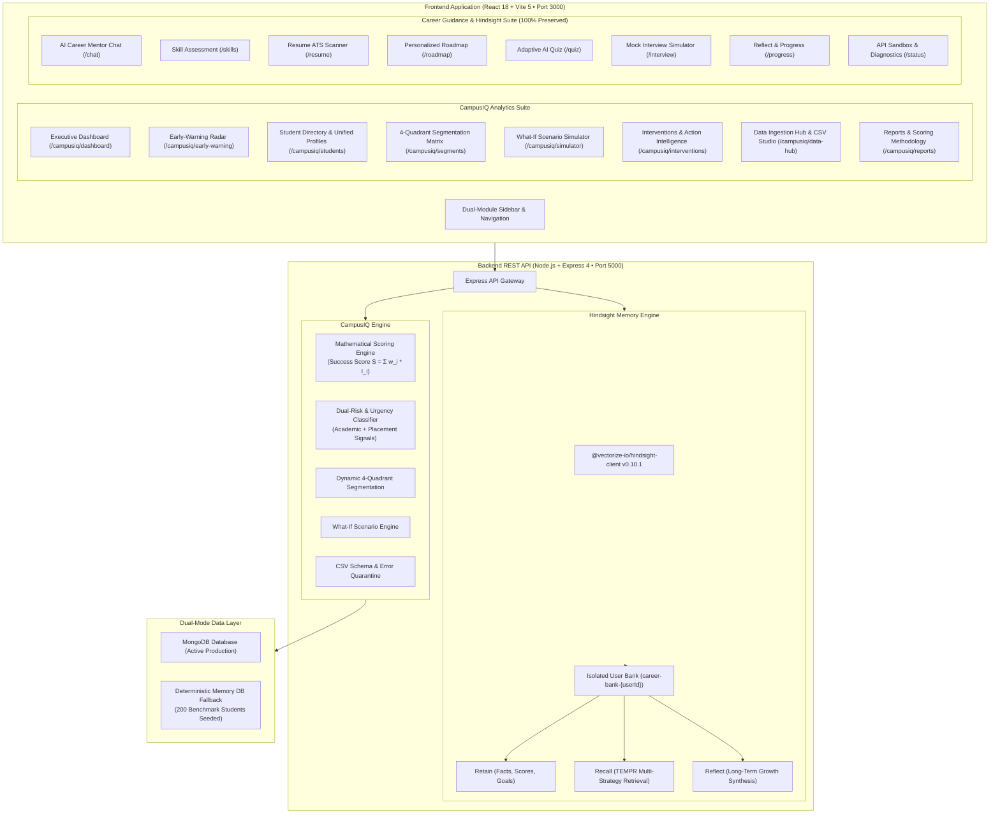

# 🎓 CampusIQ — Smart Campus Analytics & Success Platform

> **Predict. Explain. Intervene. Measure.**  
> *AI-Powered Student Analytics and Institutional Success Platform developed for the KPMG in India Hackathon Challenge, seamlessly integrated with a production-grade Hindsight-powered AI Career Mentorship suite.*

---

## 🌐 Live Prototype & Public Access

- **Public Cloudflare Tunnel URL:** [https://luis-significantly-frontpage-campbell.trycloudflare.com](https://luis-significantly-frontpage-campbell.trycloudflare.com)
- **Local Development URL:** `http://localhost:3000` (Frontend) • `http://localhost:5000` (Backend API)
- **GitHub Repository:** [gayathripusapati74-eng/-Career-Guidance-AI-hindsight](https://github.com/gayathripusapati74-eng/-Career-Guidance-AI-hindsight.git)
- **Pre-Seeded Benchmark Dataset:** 200 Students across 4 Departments (CSE, IT, ECE, MECH) and 4 Academic Years generated with deterministic PRNG (seed = 42).

---

## 📌 Executive Summary & Hackathon Challenge Alignment

Colleges and universities in India face high student attrition, backlogs, and poor placement readiness because student data is fragmented across siloed systems (Biometric Attendance ERPs, SIS exam records, LMS video portals, and Training & Placement spreadsheets). Institutional advisors only learn a student is in trouble when they have already failed a semester or missed hiring cutoffs.

**CampusIQ** transforms campus administration from **reactive firefighting** to **predictive, explainable intervention**:

1. **Unifies 8 Data Modalities:** Integrates academic records, biometric attendance, LMS portal telemetry, placement assessment scores, skills rubrics, and feedback into a unified student record.
2. **Dual-Risk Early Warning:** Decouples academic struggle from placement unpreparedness, generating explainable risk alerts ranked by priority urgency.
3. **Transparent Mathematical Scoring:** Uses a deterministic, weighted scoring algorithm with dynamic normalization for incomplete data—*no unexplainable black-box machine learning*.
4. **What-If Scenario Sandbox:** Allows mentors and students to simulate target attendance, GPA, and coding improvements before assigning intervention plans.
5. **Closed-Loop Action Intelligence:** Assigns faculty mentors, sets remediation milestones, logs follow-up metrics, and computes measured before-and-after deltas.
6. **Preserved AI Career Mentor with Hindsight:** Retains 100% of the existing full-stack AI career guidance portal, powered by live biomimetic long-term memory via **Hindsight Cloud**.

---

## 🏗️ System Architecture



---

## 🔬 Mathematical Formulation & Transparent Scoring

Unlike black-box models that produce arbitrary probabilities, CampusIQ employs a transparent multi-criteria formula.

### 1. Student Success Score ($S$)
$$S = \sum_{i=1}^{n} w_i \times I_i$$

Where component sub-scores $I_i$ are normalized to $[0, 100]$:

| Indicator ($I_i$) | Institutional Weight ($w_i$) | Normalization Formula & Rules |
| :--- | :---: | :--- |
| **Academic Performance** | **30%** | $(GPA / 10) \times 100 - (\text{Backlogs} \times 4)$ |
| **Attendance Regularity** | **20%** | Biometric ERP Attendance Percentage ($0 - 100\%$) |
| **Placement Readiness** | **20%** | $(0.50 \times \text{Coding}) + (0.30 \times \text{Aptitude}) + (0.20 \times \text{Interview})$ |
| **LMS Engagement** | **15%** | $(0.40 \times \text{Video}) + (0.40 \times \text{Assignment Rate}) + (0.20 \times \text{Login Frequency})$ |
| **Skill Matrix** | **10%** | $(0.60 \times \text{Technical Prof}) + (0.40 \times \text{Soft Skills Prof})$ |
| **Campus Participation** | **5%** | Club leadership, Hackathons, and Peer Tutoring score |

### 2. Provisional Normalization for Missing Indicators
In real campus operations, first-year students lack placement tests, or biometric data may be delayed. **CampusIQ never penalizes missing data as zero.** Instead, it dynamically re-normalizes weights across available indicators:

$$S_{\text{provisional}} = \frac{\sum_{i \in \text{Available}} w_i \times I_i}{\sum_{i \in \text{Available}} w_i}$$

Records with missing modalities are clearly flagged with `isProvisional: true` and display their exact `dataCoverage%`.

### 3. Decoupled Dual-Risk Detection & Urgency Score
Students are classified across two independent risk axes:
- **Academic Risk:** Triggered when Attendance $< 75\%$, GPA $< 6.5$, Backlogs $\ge 1$, or prolonged LMS inactivity ($> 14$ days).
- **Placement Readiness Risk:** Triggered when Coding score $< 60/100$, Aptitude $< 55/100$, or Mock interview $< 50/100$.

The **Priority Urgency Score** ranks the Early-Warning Radar queue:
$$\text{Urgency} = (0.55 \times \text{AcademicRisk}) + (0.35 \times \text{PlacementRisk}) + (20 \text{ if Declining Trend}) + (\text{Backlogs} \times 10)$$

---

## 🧭 The 6 Pillars of CampusIQ

### Pillar 1: Unify (Multi-Modal Data Integration Hub)
- Connects across 8 campus data pillars: Academic (SIS), Attendance ERP, LMS Platform, Placement Cell, Skill Assessments, Extracurriculars, Course Feedback, and Student Master.
- Ingestion Studio with downloadable sample CSV templates.
- Schema verification, duplicate detection, and rejected row quarantine with line numbers and reasons.
- **One-Click Reset:** Instantly restore the 200 synthetic benchmark students generated with PRNG seed=42.

### Pillar 2: Detect (Early-Warning Radar)
- Live priority queue ranking students by urgency score.
- Color-coded badges for Critical, High, Medium, and Low risk.
- Department, academic year, and risk-level multi-filters.
- Audit review modal to acknowledge, investigate, or resolve alerts with faculty audit logs.

### Pillar 3: Explain (Unified Student Profiles)
- Comprehensive student view with photo placeholder, department, semester, and assigned faculty mentor.
- Transparent score breakdown cards showing exact contributions and data coverage.
- Dual-Risk explainable evidence with dates (e.g., *"Attendance dropped to 58% on Oct 10; 2 active theory backlogs"*).
- Timeline of recent LMS logins, quiz submissions, and intervention history.

### Pillar 4: Simulate (What-If Scenario Sandbox)
- Non-destructive hypothetical sandbox for faculty advisors and students.
- Sliders for Attendance ($30-100\%$), GPA ($3.0-10.0$), Backlogs ($0-6$), Coding ($10-100$), and LMS engagement.
- Side-by-side comparison of baseline vs. simulated Success Score with delta points ($+14.5$ pts).
- Shows risk level boundary shifts (e.g., High $\rightarrow$ Low) and key drivers.
- Clear ethical disclaimer: *Simulations are decision-support models and do not alter official transcripts.*

### Pillar 5: Intervene (Action Intelligence)
- Closed-loop intervention management: Create, assign, track, and resolve.
- Categories: Academic Remedial, Placement Accelerator, Attendance Recovery, 1-on-1 Mentorship, Wellness Support.
- Tracks assigned mentor, due date, follow-up date, and priority.
- Update modal records post-intervention metrics and automatically computes before-and-after outcome deltas.

### Pillar 6: Measure (Reports & Governance)
- Institutional CSV export endpoints:
  - `Risk Register CSV`: All students currently flagged with academic or placement risk.
  - `4-Quadrant Segments CSV`: Student cohort distribution across campus.
  - `Interventions Log CSV`: Complete faculty action history and measured outcomes.
  - `Campus Master CSV`: Full records across all 200 benchmark students.
- Ethical AI charter documenting non-punitive decision support, demographic neutrality, and explainability.

---

## 4-Quadrant Student Segmentation Matrix

```text
               High Academic Performance
                          ▲
                          │
       QUADRANT II        │       QUADRANT I
     Placement Focus      │     High Performers
 (Strong GPA, Needs Coding)│  (Top Academics & Coding)
                          │
 ◄────────────────────────┼────────────────────────►
                          │            Placement Readiness
       QUADRANT IV        │       QUADRANT III
    Intensive Support     │     Academic Support
 (Dual Academic & Coding) │  (Strong Coding, Low Attendance)
                          │
                          ▼
               Low Academic Performance
```

1. **Quadrant I — High Performers:** Research mentorship, Tier-1 high-frequency placement tracks, peer tutoring leadership.
2. **Quadrant II — Placement Focus:** 4-Week intensive coding accelerator, corporate technical interview bootcamps, DSA drills.
3. **Quadrant III — Academic Support:** Faculty theory tutorials, attendance recovery counseling, backlog mitigation study cohorts.
4. **Quadrant IV — Intensive Support:** Dedicated 1-on-1 faculty mentor, Dean academic contract, wellness & mental health support.

---

## 🤖 Preserved Hindsight Cloud AI Career Mentor Suite

The original **Career Guidance AI** application is 100% operational alongside CampusIQ:

- **AI Career Mentor Chat (`/chat`):** Grounded by Hindsight Cloud long-term memory with transparent inspection of recalled memories.
- **Skill Assessment (`/skills`):** Numerical evaluation across 9 core engineering skills; automatically retains scores into Hindsight.
- **Resume ATS Evaluator (`/resume`):** Evaluates PDF/TXT resumes, scores ATS alignment, detects missing skills, and retains profile insights.
- **Personalized Roadmap (`/roadmap`):** 6-phase milestone tracker with interactive phase completions retained in Hindsight.
- **Adaptive AI Quiz (`/quiz`):** Domain quizzes with weak topic extraction and automated memory tracking.
- **Mock Interview Simulator (`/interview`):** Turn-by-turn technical interview practice with coaching debriefs.
- **Progress & Reflect (`/progress`):** Features **Hindsight Reflect**, synthesizing candidate growth across historical assessments.
- **System Diagnostics (`/status`):** Probes for MongoDB, AI engine, and Hindsight Cloud API connectivity.

---

## 🧪 Automated Testing & Verification Suite

The repository includes comprehensive automated test suites covering both CampusIQ and Hindsight memory operations:

### 1. CampusIQ Smart Analytics Test Suite (`backend/tests/campusiq.test.js`)
```bash
node backend/tests/campusiq.test.js
```
**Results: 33 Passed, 0 Failed (100% PASS)**
- `GET /api/campusiq/analytics`: 200 OK (200 benchmark students, calculated averages, distributions)
- `GET /api/campusiq/students`: 200 OK (Pagination, department filtering, sorting)
- `GET /api/campusiq/students/:id`: 200 OK (Unified profile, score breakdown, evidence reasons)
- `GET /api/campusiq/at-risk`: 200 OK (Priority queue sorted by urgency score)
- `POST /api/campusiq/at-risk/review`: 200 OK (Audit trail review status update)
- `GET /api/campusiq/segments`: 200 OK (4 quadrants with institutional programs)
- `POST /api/campusiq/simulate`: 200 OK (What-If calculation with delta points & drivers)
- `POST /api/campusiq/interventions`: 201 Created (Targeted intervention creation)
- `PATCH /api/campusiq/interventions/:id`: 200 OK (Follow-up metrics & observed outcomes)
- `POST /api/campusiq/data-hub/upload`: 200 OK (CSV validation: valid rows merged, invalid quarantined)
- `GET /api/campusiq/reports/export`: 200 OK (CSV download with text/csv header)
- `POST /api/campusiq/data-hub/reset-demo`: 200 OK (Restores clean 200-student benchmark)

### 2. Hindsight Cloud Memory Suite (`backend/tests/memory.test.js`)
```bash
node backend/tests/memory.test.js
```
**Results: 100% PASS**
- `GET /api/memory/status`: 200 OK (`api_version: 0.10.2`, live Hindsight Cloud connection)
- `POST /api/memory/retain`: 200 OK (Biomimetic ingestion into isolated user memory bank)
- `POST /api/memory/recall`: 200 OK (TEMPR multi-strategy semantic & keyword retrieval)
- `POST /api/memory/reflect`: 200 OK (Agentic growth synthesis with evidence attribution)

### 3. Frontend Production Build
```bash
cd frontend && npm run build
```
**Results: 0 Errors (Built cleanly with Vite 5.4 in 3.78s)**

---

## 🎤 5-Minute Hackathon Demo Script for Judges

| Time | Stage | Action & Key Talking Points |
| :---: | :--- | :--- |
| **0:00 - 0:45** | **The Problem & Unification** | Open **CampusIQ Overview** (`/campusiq/dashboard`). Point out the **200 benchmark students**, **66.3 average success score**, and **97% data completeness**. Explain how campus data was previously scattered across SIS, biometric attendance, and LMS. CampusIQ unifies them into a single record. |
| **0:45 - 1:45** | **Early Warning & Explainability** | Click **Early-Warning Radar** (`/campusiq/early-warning`). Show the prioritized queue ranked by **Urgency Score**. Open student `STU2026-077`. Highlight the **Dual-Risk Detection**: Attendance is 58% (Academic Warning), but Coding is 74% (Placement Ready). Show the timestamped evidence. Click **Acknowledge Alert** to demonstrate audit logging. |
| **1:45 - 2:30** | **4-Quadrant Segmentation** | Navigate to **4-Quadrant Matrix** (`/campusiq/segments`). Explain how deans can view students grouped into *High Performers*, *Placement Focus*, *Academic Support*, and *Intensive Support*. Click *Placement Focus* to show recommended actions (*4-Week Coding Accelerator*). |
| **2:30 - 3:30** | **What-If Sandbox Simulation** | Go to **What-If Simulator** (`/campusiq/simulator`). Select an at-risk student. Drag the **Attendance slider from 60% to 75%** and **Coding from 40 to 65**. Click **Recalculate Scenario Trajectory**. Show the instant $+14.5$ pts score increase and the risk boundary transitioning from High to Low. Emphasize that this is non-destructive decision support. |
| **3:30 - 4:15** | **Closed-Loop Action Intelligence** | Open **Action Intelligence** (`/campusiq/interventions`). Show the assigned tutorial plan for `STU2026-077`. Click **Update / Follow-up**, input post-remedial attendance (82%) and coding score (78%). Show how CampusIQ calculates the measured before-and-after improvement delta. |
| **4:15 - 5:00** | **Data Hub, Reports & Hindsight** | Visit **Data Ingestion Hub** (`/campusiq/data-hub`) to show CSV validation and error quarantine. Visit **Reports** (`/campusiq/reports`) to download the *Risk Register CSV*. Finally, switch to **AI Career Chat** (`/chat`) to demonstrate that the original Hindsight long-term memory chatbot is fully alive and retained. |

---

## 🔒 Synthetic Data & Ethical AI Governance Statement

1. **Synthetic Data Transparency:** The 200 student records used in this prototype are deterministically generated synthetic benchmarks (`backend/services/campusiqSeed.js`, seed = 42). They do not represent real individuals or confidential student institutional data.
2. **Augmented Decision Support:** CampusIQ does not automate disciplinary, punitive, or expulsion decisions. All scores and recommendations are advisories for human faculty mentors and advisors.
3. **Protected Demographic Neutrality:** The scoring algorithm strictly excludes student gender, caste, religion, socio-economic status, and geographic origin from scoring calculations.
4. **Right to Explanation:** Every alert is accompanied by inspectable, timestamped evidence (attendance percentages, assignment dates, and test scores) to ensure complete institutional transparency.
5. **Hackathon Disclaimer:** This project is an independent student prototype developed for the KPMG in India Hackathon challenge. It does not use KPMG logos or proprietary assets and is not an official KPMG product.

---

## 🚀 Quickstart & Local Setup Instructions

### Prerequisites
- Node.js (v18+ or v20+)
- npm (v9+)
- Optional: Local MongoDB (System defaults to in-memory fallback if MongoDB is not running)

### 1. Clone & Configure
```bash
git clone https://github.com/gayathripusapati74-eng/-Career-Guidance-AI-hindsight.git
cd -Career-Guidance-AI-hindsight
```

### 2. Backend Setup
```bash
cd backend
npm install
# .env is pre-configured with Hindsight Cloud credentials and memory DB fallback
node server.js
```
*Backend runs on `http://localhost:5000` with 200 benchmark students pre-seeded.*

### 3. Frontend Setup
```bash
cd ../frontend
npm install
npm run dev -- --host
```
*Frontend runs on `http://localhost:3000` with Vite HMR and API proxy.*

### 4. Run Automated Test Suites
```bash
# Verify CampusIQ API & Scoring Engine (33 Tests)
node backend/tests/campusiq.test.js

# Verify Hindsight Cloud Retain, Recall, Reflect
node backend/tests/memory.test.js
```

---

*Engineered with precision for KPMG in India Hackathon Challenge • Predict. Explain. Intervene. Measure.*
