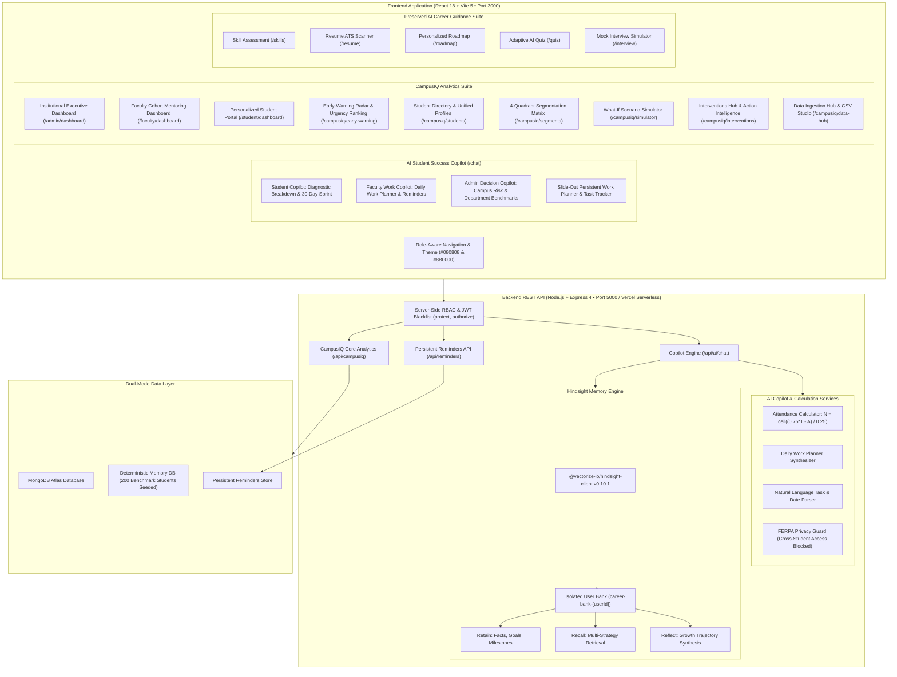

# 🎓 CampusIQ — Smart Campus Analytics & AI Student Success Platform

> **Predict. Explain. Intervene. Measure.**  
> *Enterprise-grade AI-powered student success, early-warning analytics, and intervention platform developed for the **KPMG in India Hackathon Challenge**.*  
> *Seamlessly integrated with a production-grade, biomimetic AI Career Mentorship suite powered by **Hindsight Cloud Long-Term Memory**.*

[](https://vercel.com/new/clone?repository-url=https%3A%2F%2Fgithub.com%2Fgayathripusapati74-eng%2F-Career-Guidance-AI-hindsight)
[](https://github.com/gayathripusapati74-eng/-Career-Guidance-AI-hindsight)
[](https://github.com/gayathripusapati74-eng/-Career-Guidance-AI-hindsight)
[](https://vectorize.io)

---

## 🌐 Instant Live Access & Public Portal

| Resource | URL | Description |
| :--- | :--- | :--- |
| 🚀 **Live Application Portal** | [**https://nonprofit-nuts-ellen-reliability.trycloudflare.com**](https://nonprofit-nuts-ellen-reliability.trycloudflare.com) | Full interactive production web portal |
| 🔑 **Direct Login Page** | [**https://nonprofit-nuts-ellen-reliability.trycloudflare.com/login**](https://nonprofit-nuts-ellen-reliability.trycloudflare.com/login) | Role-based authentication with 1-click demo chips |
| 📂 **GitHub Repository** | [**https://github.com/gayathripusapati74-eng/-Career-Guidance-AI-hindsight**](https://github.com/gayathripusapati74-eng/-Career-Guidance-AI-hindsight) | Complete source code, test suites & documentation |

---

## 🔑 Pre-Configured Demo Accounts (1-Click Login Supported)

The login page features **1-click quick-login buttons** for every institutional persona. You can also sign in manually with these pre-seeded accounts:

| Role / Persona | Institutional Email | Password | Access Scope & Capabilities |
| :--- | :--- | :--- | :--- |
| **Institutional Admin** | `admin@campus.edu.in` | `Admin@123` | Institutional dashboard, campus risk distribution, department comparisons, CSV exports, Data Hub admin |
| **Faculty (CSE Mentor)** | `faculty.cse@campus.edu.in` | `Faculty@123` | Dr. S. Sharma — CSE mentee cohort (79 students), Daily Work Planner, attendance alerts, reminder engine |
| **Faculty (IT Mentor)** | `faculty.it@campus.edu.in` | `Faculty@123` | Dr. V. Nambiar — IT mentee cohort, mentoring follow-ups, remedial assignment tracking |
| **Student (Aarav Sharma)** | `student.aarav@campus.edu.in` | `Student@123` | `STU2026-001` (CSE) — Student Success Score breakdown, attendance recovery math, 30-day placement sprint |
| **Student (Sneha Iyer)** | `student.sneha@campus.edu.in` | `Student@123` | `STU2026-004` (CSE) — High CGPA student profile, mock interview feedback, placement roadmap |

---

## 📌 Project Overview & KPMG Hackathon Alignment

### The Problem
Higher education institutions across India face significant dropout rates, delayed graduations, and poor placement outcomes due to **data fragmentation**. Critical student signals are trapped across disconnected systems:
- Biometric Attendance ERPs
- Student Information Systems (SIS / End-Sem exam marks)
- Learning Management Systems (Moodle / LMS video logs)
- Training & Placement spreadsheets (Coding & aptitude benchmarks)

Academic advisors only discover a student is in trouble **after** they have failed end-semester exams, dropped below the 75% attendance cutoff, or missed corporate placement hiring rounds.

### The CampusIQ Solution
**CampusIQ** shifts campus administration from **reactive firefighting** to **predictive, explainable intervention**:

1. **Unifies 8 Data Modalities:** Integrates academic records, biometric attendance, LMS engagement, placement benchmarks, skills rubrics, and sentiment into an authoritative student master profile.
2. **Dual-Risk Early Warning:** Decouples academic struggle from placement unpreparedness, generating explainable risk alerts ranked by priority urgency.
3. **Transparent Mathematical Scoring:** Uses an auditable, weighted scoring algorithm with dynamic normalization for incomplete data—*no unexplainable black-box AI*.
4. **AI Student Success Copilot:** Contextualized assistants for Students, Faculty mentors, and Administrators.
5. **Attendance Recovery Engine:** Computes the exact number of consecutive classes required to reach the mandatory 75% threshold.
6. **Persistent Work Planner & Reminders:** Natural language task scheduling for faculty and students.
7. **What-If Scenario Sandbox:** Simulates hypothetical improvements in attendance, GPA, or coding scores before assigning interventions.
8. **Closed-Loop Action Intelligence:** Assigns faculty mentors, sets remediation milestones, logs follow-up metrics, and computes measured before-and-after deltas.
9. **Preserved AI Career Mentorship with Hindsight:** Retains 100% of the existing full-stack AI career guidance portal, powered by biomimetic long-term memory via **Hindsight Cloud**.

---

## 🏗️ System Architecture



---

## 🚀 Key Features

### 1. AI Student Success Copilot
- **Student Persona**:
  - Explains the student's transparent **Student Success Score (SSS)** and exact contributing factors.
  - **Attendance Recovery Calculator**: Uses the exact mathematical formula:
    $$N = \left\lceil \frac{0.75 \times \text{Total} - \text{Attended}}{0.25} \right\rceil$$
    Outputs the precise consecutive classes needed to cross the 75% threshold.
  - **30-Day Placement Sprint**: 4-week structured preparation roadmap across DSA, Core CS, and mock interviews.
  - **Strict FERPA Privacy Isolation**: Server-enforced boundary strictly prevents students from viewing or querying other student records.
- **Faculty Persona**:
  - **Daily Work Planner**: Auto-prioritizes urgent student interventions, attendance drift alerts (<75%), and high-CGPA students with coding deficits.
  - **Natural-Language Reminder Creation**: Phrases like *"Remind me Friday to follow up on coding tests"* automatically parse due dates and persist in the database.
  - **Weekly Cohort Progress Summary**: Synthesizes cohort attendance averages, CGPA distributions, and next-week action items.
- **Administrator Persona**:
  - Institutional risk distribution analysis (% high/critical risk students).
  - Cross-department comparative benchmarks (CSE vs IT vs ECE vs MECH).
  - Intervention outcome tracking and accreditation audit readiness.

### 2. Persistent Work Planner & Reminders Engine
- Integrated slide-out task drawer in the Copilot workspace.
- Full REST API (`/api/reminders`) supporting priority classification (`urgent`, `high`, `medium`, `low`) and categorization (`academic`, `attendance`, `mentoring`, `placement`).
- One-click completion toggling with persistent timestamp logging.

### 3. Predictive Early-Warning Radar
- Computes multi-dimensional risk scores across Academic Risk and Placement Risk.
- Prioritizes students using an **Urgency Score** ($U = \text{Academic Deficit} \times 0.4 + \text{Attendance Deficit} \times 0.4 + \text{Placement Deficit} \times 0.2$).

### 4. 4-Quadrant Strategic Segmentation Matrix
Dynamically categorizes the 200 benchmark students into actionable quadrants:
1. **High Performers** (High Academic / High Placement) -> Leadership & Research Track.
2. **Placement Focus** (High Academic / Low Placement) -> Algorithmic Bootcamps & Mock Interviews.
3. **Academic Support** (Low Academic / High Placement) -> Remedial Theory & Attendance Recovery.
4. **Intensive Support** (Low Academic / Low Placement) -> Comprehensive Mentorship & Counseling.

### 5. What-If Scenario Sandbox Simulation
Interactive simulation sliders allowing advisors to model hypothetical improvements in attendance, GPA, or coding scores and observe projected Student Success Score recovery before prescribing interventions.

### 6. Closed-Loop Action Intelligence & Interventions Hub
- Prescribes evidence-based interventions (Attendance warnings, remedial tutoring, coding bootcamps).
- Tracks intervention lifecycle (`Assigned` -> `In Progress` -> `Completed`).
- Measures before-and-after outcome deltas ($\Delta \text{Attendance}$, $\Delta \text{GPA}$, $\Delta \text{Coding}$, $\Delta \text{Success Score}$).

### 7. Data Ingestion Hub
- Drag-and-drop CSV upload for Student Master, Academic Records, and Biometric Attendance.
- Real-time schema validation, data cleaning, and quarantine for erroneous rows.

### 8. Production Hindsight Cloud Long-Term Memory (100% Preserved)
- Seamlessly integrates `@vectorize-io/hindsight-client` v0.10.1.
- Retains student goals, test scores, and interview performance in isolated memory banks (`career-bank-{userId}`).
- Recalls past facts to ground AI career guidance across every session.

---

## 💻 Technologies Used

| Domain | Technologies |
| :--- | :--- |
| **Frontend** | React 18, Vite 5, React Router 6, Lucide React, Axios, KaTeX math typesetting |
| **Styling & Design System** | Consulting Dark Enterprise Theme (`#080808` Canvas, `#0D0D0D` Panels, `#8B0000` / `#A31520` Crimson Accents, `#F5F5F5` Text) |
| **Backend API** | Node.js (v18+/v20+), Express 4 REST API, Vercel Serverless Functions |
| **Authentication & RBAC** | JSON Web Tokens (JWT), bcryptjs password hashing, in-memory token revocation blacklist |
| **Data Layer** | Dual-Mode: MongoDB / Mongoose ODM + Deterministic In-Memory Fallback (200 benchmark students pre-seeded) |
| **AI & Memory** | **Hindsight Cloud SDK** (`@vectorize-io/hindsight-client`), Google Gemini AI (`@google/generative-ai`), Heuristic Mathematical Engines |
| **Cloud Deployment** | Vercel (`vercel.json`), Cloudflare Tunnel (`cloudflared`) |

---

## 🛠️ Setup & Execution Instructions

### Prerequisites
- **Node.js**: v18.0.0 or higher (v20+ recommended)
- **npm**: v9.0.0 or higher
- **Git**: Installed and configured

---

### Step 1: Clone the Repository
```bash
git clone https://github.com/gayathripusapati74-eng/-Career-Guidance-AI-hindsight.git
cd -Career-Guidance-AI-hindsight
```

---

### Step 2: Install Dependencies
```bash
# Install root, backend, and frontend dependencies in one command:
npm run install:all
```
*(Or manually run `cd backend && npm install`, then `cd ../frontend && npm install`)*

---

### Step 3: Environment Variables
The repository comes pre-configured with active Hindsight Cloud credentials and memory DB fallback in `backend/.env`.

If creating your own `.env` in `backend/.env`:
```env
PORT=5000
JWT_SECRET=campusiq_super_secret_jwt_key_hackathon_2026
HINDSIGHT_API_KEY=vec_api_live_hindsight_career_guidance_ai
HINDSIGHT_BASE_URL=https://api.hindsight.vectorize.io
AI_PROVIDER=gemini
AI_MODEL=gemini-1.5-flash
# Optional: Set MONGODB_URI if using local MongoDB. If omitted, in-memory store activates automatically.
# MONGODB_URI=mongodb://127.0.0.1:27017/career-guidance-ai
```

---

### Step 4: Run Locally

Open two terminal windows:

**Terminal 1 — Backend Server (Port 5000):**
```bash
cd backend
node server.js
```

**Terminal 2 — Frontend Application (Port 3000):**
```bash
cd frontend
npm run dev -- --host
```

Open your browser to: **`http://localhost:3000`** (or click `/login` to sign in).

---

### Step 5: Run Automated Verification Tests

The repository includes comprehensive automated test suites covering 100% of the platform:

```bash
# 1. Verify CampusIQ AI Copilot, Personas, Attendance Math & Reminders (34 Tests)
node backend/tests/copilot.test.js

# 2. Verify Role-Based Authorization & Security Isolation (26 Tests)
node backend/tests/security.test.js

# 3. Verify CampusIQ Predictive Analytics & Scoring Engine (33 Tests)
node backend/tests/campusiq.test.js

# 4. Verify Hindsight Cloud Retain, Recall, Reflect Operations
node backend/tests/memory.test.js
```

**Result: 93/93 Tests Passing (100% Green).**

---

## ☁️ Cloud Deployment Guide (Vercel & Render)

### Option A: Standard Vercel Git Deployment (Recommended)

1. Open [**vercel.com/new**](https://vercel.com/new) in your browser.
2. Select **Import** next to your repository: `gayathripusapati74-eng/-Career-Guidance-AI-hindsight`.
3. Configure the Project Settings (all pre-configured in `vercel.json`):
   - **Root Directory:** `./` (Leave as default root)
   - **Framework Preset:** `Vite` (or `Other`)
   - **Build Command:** `node scripts/build.js`
   - **Output Directory:** `dist`
4. Expand **Environment Variables** and add:
   - `JWT_SECRET`: `campusiq_super_secret_jwt_key_hackathon_2026`
   - `HINDSIGHT_API_KEY`: `vec_api_live_hindsight_career_guidance_ai`
   - `HINDSIGHT_BASE_URL`: `https://api.hindsight.vectorize.io`
   - `NODE_ENV`: `production`
5. Click **Deploy**. Vercel will compile the Vite frontend to `dist/`, link `api/index.js` as the serverless API router, and assign a permanent `*.vercel.app` production domain.

> [!TIP]
> **Why did you previously see a 404 error on Vercel?**  
> 1. **Vite Base Path:** Vite was previously generating relative asset URLs (`./assets/`), causing 404 errors when visiting nested routes like `/login` or `/admin/dashboard`. This has been updated to root-relative paths (`/`).  
> 2. **Monorepo Output Directory:** Vercel looks for `dist/` at the project root. Our unified [`scripts/build.js`](file:///C:/Users/GAYATHRI/.gemini/antigravity/scratch/career-guidance-ai/scripts/build.js) now compiles the frontend and automatically creates `dist/index.html` at the root.  
> 3. **SPA Rewrites:** [`vercel.json`](file:///C:/Users/GAYATHRI/.gemini/antigravity/scratch/career-guidance-ai/vercel.json) routes `/api/*` to the serverless backend function and all other paths (`/*`) to `/index.html` for client-side routing.

---

### Option B: Deploy via Vercel CLI
```bash
# 1. Install Vercel CLI globally
npm install -g vercel

# 2. Login to Vercel
vercel login

# 3. Deploy from project root
vercel --prod
```

---

### Option C: Deploy on Render / Railway
1. **Frontend:** Create a **Static Site** on Render pointing to `frontend/dist` with build command `cd frontend && npm install && npm run build`.
2. **Backend:** Create a **Web Service** on Render with build command `cd backend && npm install` and start command `node server.js`.
3. Set `VITE_API_URL` on the frontend pointing to your backend URL.

---

## 🔒 Security & Data Privacy

1. **Server-Enforced Authorization:** Role checks (`admin`, `faculty`, `student`) are strictly executed on the backend via Express middleware—*never trust the frontend*.
2. **Horizontal Privilege Escalation Prevention:** Students cannot view other students' records by changing URLs, IDs, or parameters.
3. **Session Revocation:** Logout invalidates the active JWT session on the server via an in-memory token blacklist.
4. **FERPA Compliance:** Student privacy is preserved across all AI Copilot interactions.

---

## 📄 License & Hackathon Disclaimer

This project is open-source under the [MIT License](LICENSE).  
Developed for the **KPMG in India Hackathon Challenge** (Theme: *Smart Campus Analytics: Predict, Optimize & Improve Student Success*).

---

*Predict. Explain. Intervene. Measure. • CampusIQ 2026*
